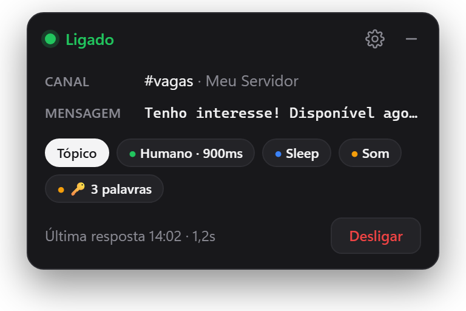
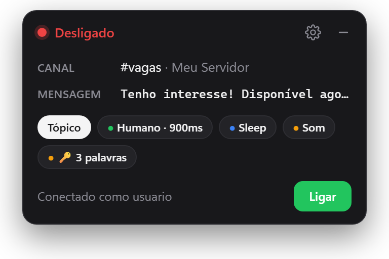
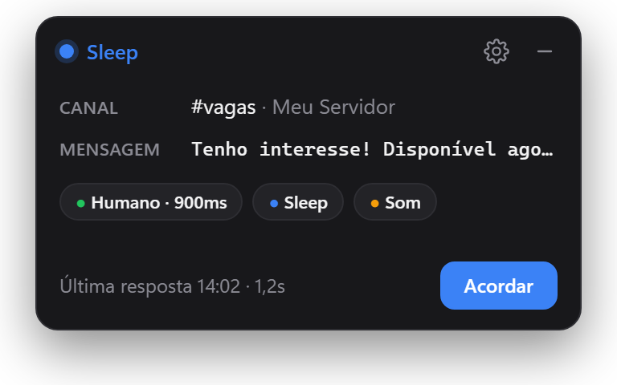
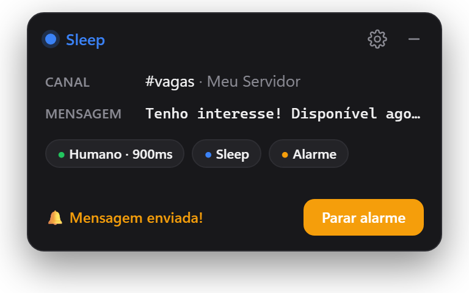
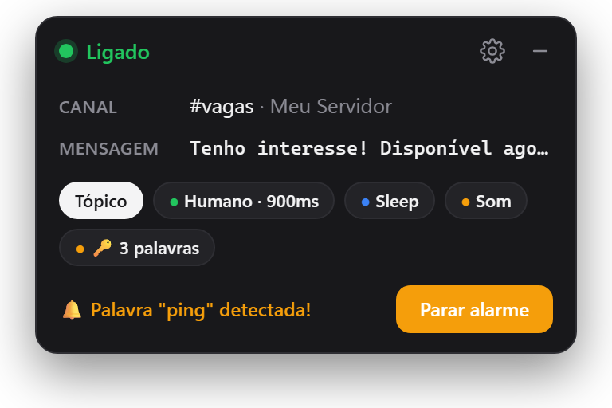
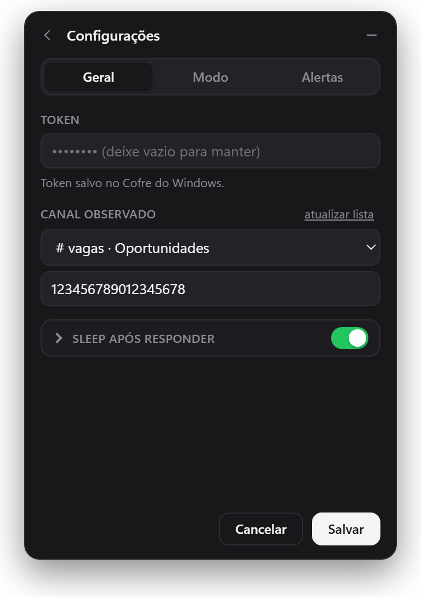
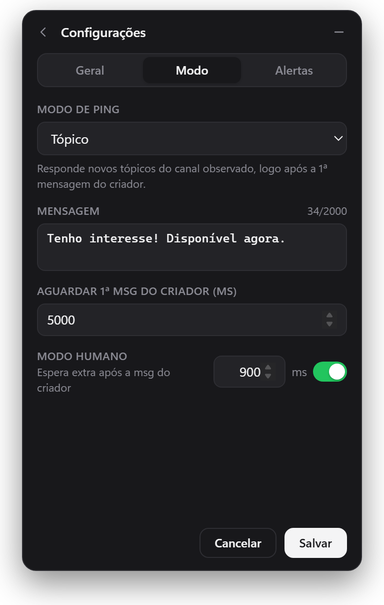
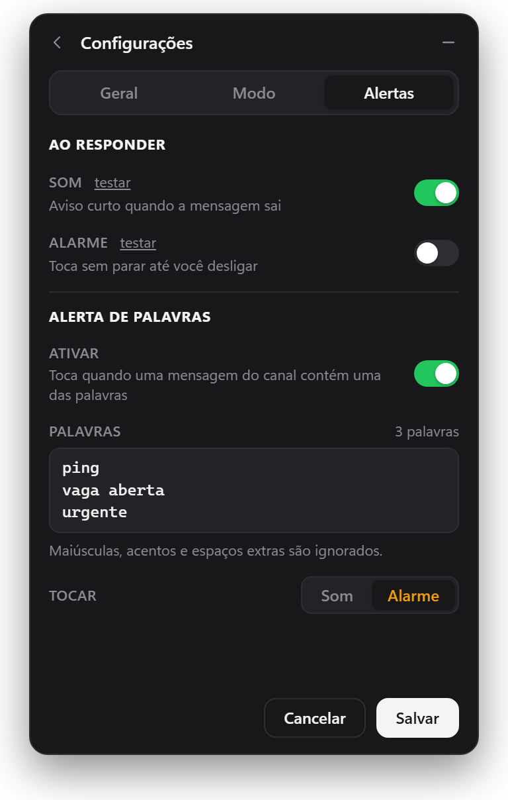
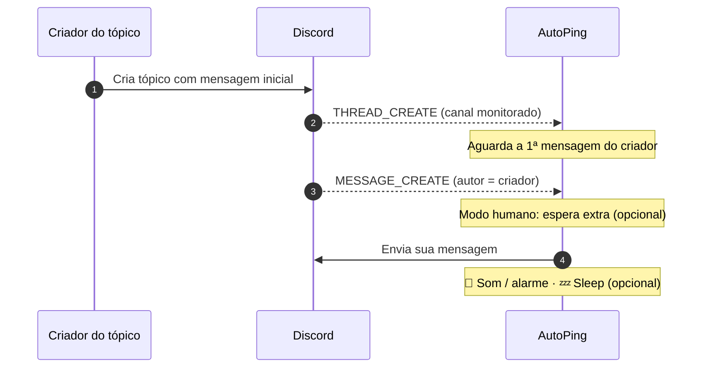
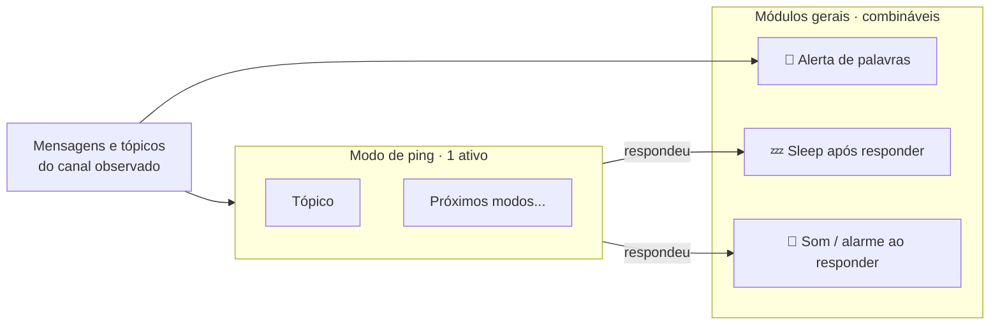

<div align="center">


# AutoPing

**Seja o primeiro a responder.** Monitora um canal do Discord e responde automaticamente a novos tópicos — sempre logo após a mensagem do criador.

[](https://github.com/GustavoAns/autoPing/releases/latest)
[](https://github.com/GustavoAns/autoPing/actions/workflows/ci.yml)


[](LICENSE)

[**⬇️ Baixar para Windows**](https://github.com/GustavoAns/autoPing/releases/latest) &nbsp;·&nbsp; [Como funciona](#-como-funciona) &nbsp;·&nbsp; [Desenvolvimento](#%EF%B8%8F-desenvolvimento)

<br />



</div>

> [!WARNING]
> O AutoPing usa a **sua conta de usuário** (self-bot), o que viola os Termos de Serviço do Discord e pode resultar em banimento da conta. Use por sua conta e risco.

---

## ✨ Funcionalidades

| | |
|---|---|
| ⚡ **Resposta em milissegundos** | Conexão própria com o Discord, sem bibliotecas intermediárias, com conexões HTTPS sempre aquecidas |
| 👤 **Ordem natural** | Responde *depois* da mensagem inicial do criador do tópico — nunca antes |
| 🎭 **Modo humano** | Espera extra configurável após a mensagem do criador |
| 💤 **Sleep após responder** | Pegou a vaga? O AutoPing desliga sozinho até você acordá-lo |
| 🔔 **Som e modo alarme** | Aviso ao enviar ou alarme contínuo até você voltar ao PC |
| 🔑 **Alerta de palavras** | Toca som ou alarme quando alguém escreve no canal uma palavra que você escolheu (`PinG` = `ping` = `PÍNG`) |
| 🧩 **Modos e módulos** | Escolha *um* modo de ping (hoje: **Tópico**) e combine os módulos gerais que quiser ([como funciona](#-modos-e-módulos)) |
| 🟢 **Status na bandeja** | Ícone muda de cor: ligado, desligado, sleep e pisca no alarme |
| 🪶 **Levíssimo** | Oculto na bandeja usa **~12 MB de RAM** e CPU praticamente zero — feito para rodar enquanto você joga |
| 🔐 **Token seguro** | Guardado no **Cofre do Windows** (criptografado), nunca em texto puro |
| 🔄 **Ajustes ao vivo** | Mude canal, mensagem ou modos sem reiniciar nem perder a conexão |

## 📸 Telas

<div align="center">
<table>
  <tr>
    <td align="center"><br /><sub><b>🟢 Ligado</b></sub></td>
    <td align="center"><br /><sub><b>🔴 Desligado</b></sub></td>
  </tr>
  <tr>
    <td align="center"><br /><sub><b>🔵 Sleep</b> (após responder)</sub></td>
    <td align="center"><br /><sub><b>🟠 Alarme</b> após responder</sub></td>
  </tr>
  <tr>
    <td align="center" colspan="2"><br /><sub><b>🔑 Alerta de palavras</b> disparado</sub></td>
  </tr>
</table>
<table>
  <tr>
    <td align="center"><br /><sub><b>⚙️ Geral</b></sub></td>
    <td align="center"><br /><sub><b>🧩 Modo</b></sub></td>
    <td align="center"><br /><sub><b>🔔 Alertas</b></sub></td>
  </tr>
</table>
</div>

## 🚀 Instalação

1. Baixe o **`AutoPing_x.y.z_x64-setup.exe`** na [página de releases](https://github.com/GustavoAns/autoPing/releases/latest) e execute.
2. Na primeira abertura, preencha:
   - **Token** — o token da sua conta ([como obter](#-obter-o-token))
   - **Canal** — escolha na lista ou cole o ID
   - **Mensagem** — o texto que será enviado
3. Clique em **Salvar**. O AutoPing passa a viver na bandeja, perto do relógio. 🟢

> [!TIP]
> Já usava a versão de console? Se houver um `.env` na pasta, o app importa token, canal e mensagem automaticamente na primeira execução.

### 🔑 Obter o token

1. Abra o Discord **no navegador** e pressione <kbd>F12</kbd>.
2. Pressione <kbd>Ctrl</kbd>+<kbd>Shift</kbd>+<kbd>M</kbd> (emulação mobile).
3. Aba **Application** → **Local Storage** → `https://discord.com` → copie o valor de `token` (sem aspas).

> [!CAUTION]
> O token dá acesso total à sua conta. **Nunca compartilhe.**

## 🧠 Como funciona

Ao criar um tópico, o Discord primeiro cria o tópico e só depois publica a mensagem inicial do criador. Responder no instante da criação faria a sua mensagem aparecer **acima** da do criador — estranho e suspeito. O AutoPing espera essa primeira mensagem e responde logo em seguida:



Se o criador não escrever nada dentro do tempo limite (ex.: tópico criado a partir de uma mensagem existente), o AutoPing envia mesmo assim.

### 🧩 Modos e módulos

O AutoPing é dividido em duas partes:

| | **Modo de ping** | **Módulos gerais** |
|---|---|---|
| O que é | A estratégia de resposta: *quando* e *o que* enviar | Recursos extras que funcionam junto com qualquer modo |
| Quantos ativos | **Um por vez** (escolhido na aba **Modo**) | **Quantos quiser** (cada um liga/desliga sozinho) |
| Onde configura | Aba **Modo** | Abas **Geral** e **Alertas** |



**Modos disponíveis**

| Modo | O que faz |
|---|---|
| **Tópico** | Responde novos tópicos do canal observado, logo após a 1ª mensagem do criador |

Novos modos (outras formas de pingar) entram na lista sem mudar o resto: os módulos gerais continuam valendo para eles automaticamente.

**Módulos gerais**

| Módulo | Quando age | Depende do status? |
|---|---|:---:|
| 💤 **Sleep após responder** | Depois que o modo responde, desliga o bot até você acordá-lo | — |
| 🔔 **Som / alarme ao responder** | Depois que o modo responde | Sim (só há resposta com o bot ligado) |
| 🔑 **Alerta de palavras** | Quando chega no canal uma mensagem com uma das suas palavras | **Não**: funciona até com o bot desligado ou em sleep |

### 🔑 Alerta de palavras

Independente do modo e do status (funciona até com o bot desligado): quando uma mensagem enviada **no canal observado** contém uma das palavras ou frases da sua lista, o AutoPing toca **som** ou **alarme**.

- Maiúsculas, acentos e espaços extras são ignorados: `PinG`, `ping` e `PÍNG` são iguais.
- Basta *conter* o texto: `ping` também dispara em `shopping`.
- Mensagens dentro de tópicos não disparam. Suas próprias mensagens disparam (dá para testar sozinho), exceto a resposta automática do bot.

## 🖱️ Uso

| Ação | Como |
|---|---|
| Abrir / ocultar | Clique no ícone da bandeja |
| Ligar / desligar | Botão na janela ou menu da bandeja |
| Acordar do sleep | Botão **Acordar** 🔵 |
| Parar alarme | Botão **Parar alarme** 🟠, clique no ícone ou menu da bandeja (vale para resposta e alerta de palavras) |
| Configurações | Engrenagem ⚙️ |
| Sair | Menu da bandeja → **Sair** |

### Ícone da bandeja

| Ícone | Significado |
|:---:|---|
| 🟢 | Ligado — respondendo novos tópicos |
| 🔴 | Desligado |
| 🔵 | Sleep — desligou sozinho após responder |
| 🟠 piscando | Alarme tocando — mensagem enviada ou palavra detectada |
| ◯ anel vazado | Sem conexão com o Discord (reconectando ou token inválido) |

### ⚙️ Configurações

**Geral**

| Opção | Padrão | Descrição |
|---|:---:|---|
| Token | — | Salvo no Cofre do Windows; deixe vazio para manter |
| Canal observado | — | Canal de texto, fórum, mídia ou anúncios |
| Sleep após responder | ❌ | Depois de responder, desliga até você acordar |

**Modo — Tópico**

| Opção | Padrão | Descrição |
|---|:---:|---|
| Mensagem | — | Texto enviado (até 2000 caracteres) |
| Aguardar 1ª msg do criador | `5000 ms` | Tempo máximo esperando a mensagem do criador |
| Modo humano | `900 ms` ✅ | Espera extra após a mensagem do criador. Desligado = mais rápido |

**Alertas**

| Opção | Padrão | Descrição |
|---|:---:|---|
| Som ao responder | ✅ | Aviso curto quando a mensagem sai |
| Alarme ao responder | ❌ | Toca sem parar até você desligar |
| Alerta de palavras | ❌ | Lista de palavras/frases (uma por linha) + tocar **Som** ou **Alarme** |

Todas as mudanças valem **na hora**, sem reiniciar.

## 🛠️ Desenvolvimento

**Requisitos:** Windows 10/11 · [Rust](https://rustup.rs) (toolchain MSVC) · VS 2022 Build Tools (C++) · Node.js 22+

```bash
npm install      # CLI do Tauri
npm run dev      # app em modo desenvolvimento (hot reload)
npm test         # testes do core em Rust
npm run build    # .exe + instalador em src-tauri/target/release/
```

Para publicar uma versão: atualize `version` em `src-tauri/tauri.conf.json` e envie uma tag `vX.Y.Z` — o GitHub Actions compila e cria a release com o instalador.

<details>
<summary><b>📁 Estrutura do projeto</b></summary>

```
src-tauri/src/
├── lib.rs              # setup do app, comandos IPC, single-instance
├── engine.rs           # orquestra bot, gateway, REST e cache; config ao vivo
├── config.rs           # configuração persistida + validações
├── secrets.rs          # token no Cofre do Windows
├── audio.rs            # som e alarme (gerados em código)
├── tray.rs             # ícone da bandeja e menu
├── window.rs           # janela compacta
├── core/
│   ├── reply.rs        # envio comum a todos os modos: status, sleep, dedupe
│   ├── text.rs         # normalização (maiúsculas, acentos, espaços)
│   ├── modes/          # modos de ping (trait Mode + ModeRunner)
│   │   └── thread/     # modo Tópico + espera pela 1ª msg do criador
│   └── features/
│       └── keyword_alert.rs  # alerta de palavras
└── discord/
    ├── gateway.rs      # conexão WebSocket com o Discord
    ├── rest.rs         # envio de mensagens
    ├── cache.rs        # servidores e canais
    └── properties.rs   # identificação do cliente
ui/                     # interface (HTML/CSS/JS, sem framework)
```

</details>

<details>
<summary><b>📂 Onde ficam os dados</b></summary>

| O quê | Onde |
|---|---|
| Configurações | `%APPDATA%\com.autoping.desktop\config.json` |
| Logs | `%APPDATA%\com.autoping.desktop\logs\autoping.log` |
| Token | Cofre do Windows → *Credenciais genéricas* → `AutoPing` |

</details>

## 📜 Licença

[MIT](LICENSE) © GustavoAns

<div align="center"><sub>Feito com 🦀 Rust + Tauri</sub></div>
